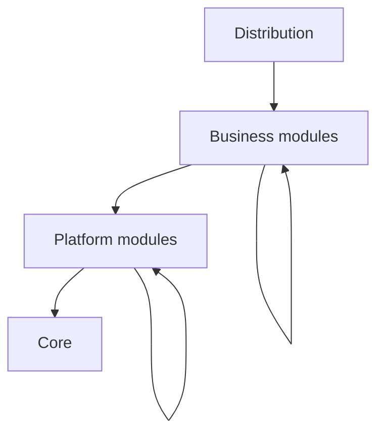

# Architecture

This page explains how Nobara is divided into a core, platform modules, and
business modules, and how a game is assembled from them. Terms in *italics*
on first use are defined in [the glossary](glossary.md).

The repository does not contain the core or any module yet. This page
describes the structure that every module follows.

## Overview

Nobara is a micro-kernel engine. A minimal *core* orchestrates, and
everything else is a *module*. A game is a *distribution*: a declared set of
modules, fixed when the game is built.

| Level | Role | Examples |
| --- | --- | --- |
| Core | Loads modules, runs the loop, schedules jobs, holds configuration and the service registry. | None: the core is not a module. |
| Platform module | A reusable foundation that other modules build on. | Rendering, block and item registries, voxel storage, physics, networking, user interface, event bus. |
| Business module | A feature of one game. | A world generator, a particle effect, a mob. |

The model resembles an operating system. The core is the kernel shared by
every system, platform modules form the environment, and business modules
are the applications. A business module is written for a given environment
and runs only in distributions that provide it.

Arrows point from a module to what it depends on.

## Modules

A module is a unit with a name, a version, a level, and declared
dependencies. The core knows nothing else about it: it has no notion of
roles such as "renderer" or "user interface".

- Granularity is fine: one feature is one module. A distribution can
  contain dozens or hundreds of modules, so dependency resolution, assembly
  loading, and registration must stay cheap at that scale.
- A module declares its dependencies in its manifest. The dependency graph
  must be acyclic.
- A dependency is *required* or *optional*. A missing required dependency is
  always an error. An optional dependency, when its target is active, counts
  in load order exactly like a required one; when it is absent the module
  works without it. Code that uses an optional dependency is isolated in
  dedicated classes so that the module loads without the dependency's
  assembly.
- A platform module never depends on a business module, even optionally. A
  business module can depend on platform modules and on other business
  modules.
- A module runs on the client, on the server, or on both. The headless
  server is the same distribution filtered to the server side.

### Extensions

An *extension* adds something to a parent module: a feature, a backend, a
transport, or a client-only part. It is a module in its own right, has the
same level as its parent, and depends on it. The core treats it like any
other module.

### Technical variants

Several implementations of the same model, such as two graphics APIs, are
split into a base module and one extension per implementation:

- the base module exposes a neutral API and a registry of backends, and
  contains no third-party library code;
- each backend extension registers itself with the base module;
- other modules depend on the base module and never on a backend;
- the base module selects the backend at run time among the ones present,
  based on user configuration.

A distribution ships only the backends its targets need. A base module
declares on which sides (client, server) a backend is required; building
without one on such a side is an error.

Approaches that differ in model, such as a web-based user interface and a
native one, are not variants. They expose different APIs, and a module is
written for one of them.

## Compatibility

No standard interface is imposed across platform modules. Two modules with
the same purpose may have incompatible models, because a common interface
would reduce both to the lowest common denominator. The one stable contract
is the core's, which therefore changes as little as possible.

A module declares dependencies on specific modules and versions. There is no
"environment" concept and no mechanism for one module to declare itself
compatible with another.

Dependencies, conflicts, and reservations are checked when the distribution
is built and checked again when modules are loaded.

## Distributions

A distribution is described by two files that are compiled into a
distribution manifest:

- a project file for its structure: which modules, which targets;
- an engine file for the behavior of the engine: configuration defaults,
  locked values.

Every module a distribution uses must be declared in it; an undeclared
module is never loaded. The composition is fixed when the distribution is
built. In a given distribution, every module that the build target does not
disable is active.

Several modules with the same purpose can be active together as long as they
do not collide. A module reserves the exclusive resources it uses by opaque
names, such as a main window or a graphics context. The core guarantees that
each name has a single holder and reports conflicts. A module can also
declare an explicit incompatibility with another module.

## Communication

Modules communicate through three mechanisms, plus extension points of their
own.

| Mechanism | Use | Lives in |
| --- | --- | --- |
| Service registry | Direct, typed calls into a module's API. | Core |
| Event bus | Decoupled notifications. | A platform module |
| Entity component system | The game world: entities, components, systems. | A platform module |

### Service registry

A module that depends on another references its assembly and calls its
interfaces directly, so an incompatible API change fails at compile time.
Assembly references are generated from the module manifest, which is the
only source of dependencies.

The registry maps a service type to the instance a module publishes. It does
not know what a service is for. It refuses a request for a service of a
module that the caller did not declare as a dependency, and returns "absent"
for the service of an inactive optional dependency. There is one registry per
context, and contexts of the same process share no service.

The registry is distinct from the content registries (blocks, items,
entities). Those are platform modules.

### Event bus

The event bus is a platform module, not part of the core. A module that
publishes or listens to events depends on it like on any other module. The
bus is not used on hot paths: mass changes, such as thousands of blocks
destroyed by one explosion, go through the entity component system and
batched notifications.

### Entity component system

The world is an entity component system, provided by a platform module. The
core does not know the world. A module that acts on the world declares
components and registers systems with that module. A grid of voxels is an
entity, and its chunks form a separate structure managed by the voxel module
and referenced from that entity.

### Module extension points

For hot paths where the event bus does not fit, a module can publish its own
extension points, as ordinary services: batched change notifications, hooks
per block type, handlers for item components, registries of backends.

## Threading

Loop threads and the job system belong to the core. No module creates a
thread.

- There is one loop thread per context.
- A pool of worker threads, shared between contexts, runs jobs.
- Systems declare which data they read and write, or work on a copy and
  apply the result afterward.
- `async` is for I/O outside hot paths, and returns to the loop thread of the
  context through a synchronization point.

The core provides the mechanics of the loop: loop threads, coarse phases, an
accumulator, and a fixed simulation tick. A platform module, `nGame`, owns
the simulation tick. It splits the simulation phase into ordered, extensible
steps, schedules every system of the tick, and keeps game time: pause, time
scale, tick rate, and raw clocks per dimension.

## Configuration

The core manages configuration: player settings and distribution settings.
Each module declares its keys (name, type, default, bounds, and scope `user`
or `distribution`) in its manifest. The distribution can change defaults,
lock values, or fix the keys with distribution scope. The player's file is
readable XML in the user data folder.

## Performance constraints

The garbage collector is the main performance constraint. On hot paths,
which are marked with the `[HotPath]` attribute:

- no managed allocation, no LINQ, no capturing closure, no boxing;
- large data lives in unmanaged memory or in pools;
- low-level code uses `Span<T>`, `stackalloc`, `struct`, and `ref struct`.

Fine-grained calls between modules, one per block or per entity, are
expensive on hot paths. Services favor batch operations, and bulky data
travels through the entity component system or shared structures such as
chunks and buffers.

## Loading

Modules are loaded in dependency order. The build target selects the mode:
separate assemblies, or a static mode in which modules are linked into the
executable, for platforms that cannot load assemblies dynamically.

## See also

- [Glossary](glossary.md)
- [Documentation guide](../contributing/documentation.md)
