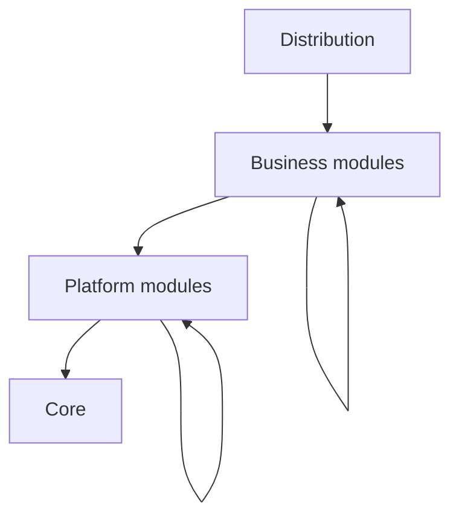

# Architecture

This page explains how Nobara is divided into a core, platform modules, and
business modules, and how a game is assembled from them. Terms in *italics*
on first use are defined in [the glossary](glossary.md).

The core lives in `src/Core/`; see [its module sheet](../../src/Core/README.md)
for what it provides. The repository contains no module yet. This page
describes the structure that every module follows.

## Overview

Nobara is a micro-kernel engine. A minimal *core* orchestrates, and
everything else is a *module*. A game is a *distribution*: a declared set of
modules, fixed when the game is built.

| Level | Role | Examples |
| --- | --- | --- |
| Core | Loads modules, runs the loop, schedules jobs, holds configuration and the service registry. | None: the core is not a module. |
| Platform module | A reusable foundation that other modules build on. | Rendering, block and item registries, voxel storage, physics, networking, user interface, event bus. |
| Business module | A feature of one game. | A world generator, a particle effect, a mob. |

The model resembles an operating system. The core is the kernel shared by
every system, platform modules form the environment, and business modules
are the applications. A business module is written for a given environment
and runs only in distributions that provide it.

Arrows point from a module to what it depends on.

## Modules

A module is a unit with a name, a version, a level, and declared
dependencies. The core knows nothing else about it: it has no notion of
roles such as "renderer" or "user interface".

- A module covers a single feature, so a distribution quickly reaches dozens
  or hundreds of them. Start-up time stays acceptable only if three
  operations remain cheap at that count: resolving dependencies, loading
  assemblies, and registering services and resources.
- A module declares its dependencies in its manifest. The dependency graph
  must be acyclic.
- A dependency is *required* or *optional*. A missing required dependency is
  always an error. An optional dependency, when its target is active, counts
  in load order exactly like a required one; when it is absent the module
  works without it. Code that uses an optional dependency is isolated in
  dedicated classes so that the module loads without the dependency's
  assembly.
- A platform module never depends on a business module, even optionally. A
  business module can depend on platform modules and on other business
  modules.
- A module runs on the client, on the server, or on both. The headless
  server is the same distribution filtered to the server side.

### Extensions

An *extension* adds something to a parent module: a feature, a backend, a
transport, or a client-only part. It is a module in its own right, has the
same level as its parent, and depends on it. The core treats it like any
other module.

### Technical variants

Several implementations of the same model, such as two graphics APIs, are
split into a base module and one extension per implementation:

- the base module exposes a neutral API and a registry of backends, and
  contains no third-party library code;
- each backend extension registers itself with the base module;
- other modules depend on the base module and never on a backend;
- the base module selects the backend at run time among the ones present,
  based on user configuration.

A distribution ships only the backends its targets need. A base module
declares on which sides (client, server) a backend is required; building
without one on such a side is an error.

Approaches that differ in model, such as a web-based user interface and a
native one, are not variants. They expose different APIs, and a module is
written for one of them.

## Compatibility

Platform modules share no standard interface. Two modules can serve the same
purpose with incompatible models, and making them interchangeable would
restrict both to the features they have in common. What stays stable across
distributions is the contract of the core, so it receives the most careful
specification and the fewest changes.

A module declares dependencies on specific modules and versions. There is no
"environment" concept and no mechanism for one module to declare itself
compatible with another.

Dependencies, conflicts, and reservations are checked when the distribution
is built and checked again when modules are loaded.

## Distributions

A distribution is described by two files that are compiled into a
distribution manifest:

- a project file for its structure: which modules, which targets;
- an engine file for the behavior of the engine: configuration defaults,
  locked values.

Every module a distribution uses must be declared in it; an undeclared
module is never loaded. The composition is fixed when the distribution is
built. In a given distribution, every module that the build target does not
disable is active.

Several modules with the same purpose can be active together as long as they
do not collide. A module reserves the exclusive resources it uses by opaque
names, such as a main window or a graphics context. The core guarantees that
each name has a single holder and reports conflicts. A module can also
declare an explicit incompatibility with another module.

## Communication

Modules communicate through three mechanisms, plus extension points of their
own.

| Mechanism | Use | Lives in |
| --- | --- | --- |
| Service registry | Direct, typed calls into a module's API. | Core |
| Event bus | Decoupled notifications. | A platform module |
| Entity component system | The game world: entities, components, systems. | A platform module |

### Service registry

A module that depends on another references its assembly and calls its
interfaces directly, so an incompatible API change fails at compile time.
Assembly references are generated from the module manifest, which is the
only source of dependencies.

The registry maps a service type to the instance a module publishes. It does
not know what a service is for. It refuses a request for a service of a
module that the caller did not declare as a dependency, and returns "absent"
for the service of an inactive optional dependency. There is one registry per
context, and contexts of the same process share no service.

The registry is distinct from the content registries (blocks, items,
entities). Those are platform modules.

### Resource system

The core manages the resource system without knowing what a resource
contains. It reads the compiled resources of every loaded module once per
process, refuses an object defined by two modules, applies the overrides,
and resolves the tags. The module that owns a resource type registers a
decoder, which turns each resource into an object of the module; every
context of the process shares the decoded objects. A content registry is
such a module. See [the core page](../../src/Core/README.md#loading-resources).

The same rule as for services applies: a module reads the resources of the
types defined by itself and by its declared dependencies. A free property is
the exception that keeps modules independent: the module that defines a
resource does not know the modules that read its free properties.

### Event bus

The event bus is a platform module, nEvent, so publishing or listening to
events requires a declared dependency on it. Its events are `struct` types,
its handlers have priorities and can cancel an event, and an event is
delivered at once or queued for the end of the tick; see [its module
sheet](../../src/nEvent/README.md). Hot paths never use the bus. Bulk
changes, for example an explosion that destroys thousands of blocks, are
handled by entity component system systems and by batched voxel
notifications.

### Entity component system

The game world is modeled as an entity component system supplied by a
platform module; the core has no knowledge of the world. To act on the world,
a module declares components and registers systems with that module. Each
grid of voxels is an entity. Its chunks are kept apart, in a structure owned
by the voxel module and referenced from the entity.

### Module extension points

For hot paths where the event bus does not fit, a module can publish its own
extension points, as ordinary services: batched change notifications, hooks
per block type, handlers for item components, registries of backends.

## Threading

Loop threads and the job system belong to the core. No module creates a
thread.

- There is one loop thread per context.
- A pool of worker threads, shared between contexts, runs jobs: small structs
  that run once, or once per index of a range in parallel batches. Jobs of the
  frame that runs pass before background jobs, such as chunk generation.
- Jobs declare which data they read and write, and the job system runs
  conflicting jobs one after the other; or they work on a copy and the loop
  thread applies the result afterward. In development mode, the declarations
  are checked when the jobs run.
- A job that throws is charged to its module, under its error policy, like an
  error in a phase.
- `async` is for I/O outside hot paths, and returns to the loop thread of the
  context through a synchronization point.

The core provides the mechanics of the loop: loop threads, coarse phases, an
accumulator, and a fixed simulation tick. A platform module, `nGame`, owns
the simulation tick. It splits the simulation phase into ordered, extensible
stages, runs every system of the tick in a deterministic order, keeps game
time (pause, time scale, tick rate, and raw clocks per dimension), and
schedules tasks; see [its module sheet](../../src/nGame/README.md). Each
system declares the data it reads and writes from the start: systems run one
after another, and the declarations are checked in development mode.

The two meet through a reservation and levers. `nGame` reserves the
simulation phase, so the other modules register their systems with it rather
than with the phase, and it receives the levers of the core on the tick:
pause, time scale, and tick rate. Without `nGame`, the simulation phase is an
ordinary phase that runs in real time at the declared rate, so the core also
runs tools and auxiliary servers on its own. The module that drives the
states of the application, `nContext`, reserves `core.contexts` the same way:
it receives the lever that creates and destroys contexts, and the stop
requests of its context, which it hands to the active state. It applies its
transitions at the start of a frame, never during the tick. See [the core
page](../../src/Core/README.md#loop) and [the nContext module
sheet](../../src/nContext/README.md).

## Configuration

The core owns two kinds of settings: those of the player and those of the
distribution. A module lists the keys it reads in its manifest, each with a
type, a default, bounds, and a scope (`user` or `distribution`). The
distribution may override defaults and lock values, and it sets every key
with distribution scope. Player values are saved as a human-readable XML file
in the user data folder.

## Performance constraints

The garbage collector is the main performance constraint. On hot paths,
which are marked with the `[HotPath]` attribute:

- no managed allocation, no LINQ, no capturing closure, no boxing;
- large data lives in unmanaged memory or in pools;
- low-level code uses `Span<T>`, `stackalloc`, `struct`, and `ref struct`.

The engine analyzers enforce these rules at compile time, together with the
absence of mutable static state, which contexts would share, and the
isolation of optional dependencies. See [the analyzer
reference](../reference/analyzers.md).

Calls across modules that handle one block or one entity at a time cost too
much on hot paths. Services therefore offer operations over batches, and
large volumes of data move through the entity component system or through
shared structures such as chunks and buffers.

## Resources

The content of a module (blocks, items, entities, textures) is described in
`.nof` files and compiled when the module is built, into protobuf data
embedded in its assembly. Errors in content therefore fail the build instead
of appearing when the game runs, and no XML is read at run time.

The compiler is generic: it knows no resource type. The module that owns a
type provides its `.proto` schema, whose options declare common constraints
(references, bounds, required fields), and, when the schema is not enough, a
build plugin in a `.Build` project that is never shipped with a game.
Modules that depend on it use its types and reference its resources, because
its assembly carries its schemas and its compiled resources. See [the `.nof`
reference](../reference/formats/nof.md).

## Loading

Modules are loaded in dependency order. The build target selects the mode:
separate assemblies, or a static mode in which modules are linked into the
executable, for platforms that cannot load assemblies dynamically.

Before any module code runs, the core checks the integrity of each module
assembly against the hash that the distribution records, reads every module
manifest from assembly metadata, and checks the composition again:
dependencies, versions, cycles, conflicts, reservations, and backends. A
module that fails these checks never runs, and the error names the module and
the cause.

## Lifecycle

Each module goes through ordered steps, numbered from 0. Discovery (0) and
loading (1) happen once per process. The other steps happen in each context,
in dependency order, and stop and release in reverse order:

- 2, registration: the module publishes its services; it resolves none.
- 3, initialization: the module resolves the services of its dependencies,
  which are all published and initialized, and creates its state.
- 4, start: last preparations before the first tick.
- 5, execution: the loop runs.
- 6 and 7, stop and release: the module ends its activity, then frees its
  resources.

Separating registration from initialization removes ordering problems: when
a module initializes, every service exists and its dependencies are ready.

When a module throws, the core applies the *error policy* that the
distribution chose for it: stop the context, disable the module and every
module that requires it, or log and continue. Required and platform modules
always stop the context. Before stopping, the core runs the emergency hooks
of the modules, such as an emergency save, and writes a crash report.

## See also

- [Glossary](glossary.md)
- [Documentation guide](../contributing/documentation.md)
