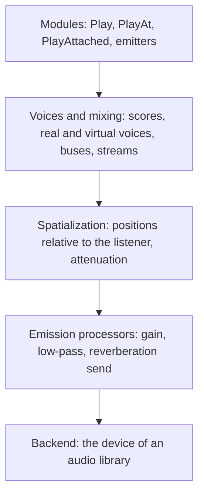

# The voices of nAudio

This page explains how [nAudio](../../src/nAudio/README.md) plays sounds: the
layers between a module and the audio device, the real and virtual voices,
the listener, and the emission processors, and why.

## The layers

Each layer only talks to the one below it. A backend is an extension that
knows one audio library; nAudio holds everything above it, so that a second
backend only translates neutral calls. The chain of emission processors is
where a future module, such as an acoustic one, changes the sounds from the
world without touching the other layers. nAudio itself registers no
processor.

Everything runs on the loop thread of the client context, in the phase
`Render`, once per frame. Plays and changes made during the ticks wait there,
so that the device receives one consistent set of changes per frame, with
the positions interpolated for that frame.

## Real and virtual voices

A device mixes a limited number of voices; a game may ask for many more, such
as a hundred blocks broken at once. Every play is a
[voice](glossary.md#voice), and nAudio keeps as many as it is asked for. At
each frame, it scores them and gives the voices of the device to the most
important:

1. the priority of the event (`High`, `Normal`, `Low`), which a designer sets;
2. the gain the player would hear: the volumes of the event, of the play, of
   the buses, the attenuation by distance, and the processors;
3. the age: the older play first.

A voice that is real already counts 1.25 times its gain, so that two voices
of close gains do not swap their voice of the device at each frame.

The other voices are [virtual](glossary.md#virtual-voice): each one keeps a
clock of its own, which goes on at its pitch. When a virtual loop becomes real
again, the device starts it at the frame its clock reached, so the loop sounds
as if it never stopped. A sound that does not loop ends at the end of its file
whether it was heard or not. A voice whose variant streams opens its stream at
that frame, and closes it when it becomes virtual again, so that a sound
nobody hears costs no decoding.

The limit of instances acts before the score: over the limit of its event, the
weakest instance ends. A louder play thus replaces the weakest one, and a
weaker play is ignored, with one rule instead of a choice between the two.

## The listener

The listener is fed like the camera of the render world: its owner moves it at
every tick, and nAudio hears it between its two last poses, by the fraction of
tick of the frame. Sounds placed with `PlayAt` and `SetPosition` follow the
same rule, and anchors are read once per tick and interpolated the same way.
The sound is thus heard where the image shows its source.

A world of Nobara is large: a position far from the origin has too few bits
of precision in single precision. nAudio subtracts the position of the
listener from the position of each sound in double precision, with
`WorldPosition.RelativeTo`, before anything reaches the device. A device only
receives positions relative to the listener, which are small: a voice farther
than the range of its event is virtual, so no position given to the device is
farther than that range.

nAudio computes the attenuation by distance itself. The score needs the gain
that the player would hear, and a backend that applied its own model would
count the distance twice. A device receives the final gain, and uses the
position only to place the sound: panning, filtering by direction (HRTF), and
the Doppler effect.

## Emission processors

An emission processor receives each voice with its position and the position
of the listener, and returns a factor of its gain, the cutoff of a low-pass
filter, and the level of a send to a
[reverberation bus](glossary.md#reverberation-bus). A processor may compute
at a lower rate than the frames, such as a few times per second for rays cast
through blocks. nAudio smooths what the chain returns, with a time constant of
50 ms, so that a step between two computations does not click. A change of
reverberation bus fades the send out of the old bus before it rises in the new
one.

Reverberation buses hold neutral parameters, in seconds and factors, that a
backend translates to its own effect. The send of a voice is taken after its
gain, so the volume of the bus of a sound applies to its reverberation too.
