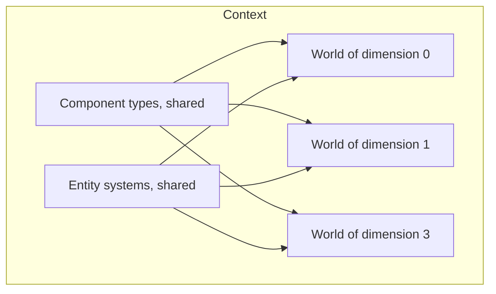
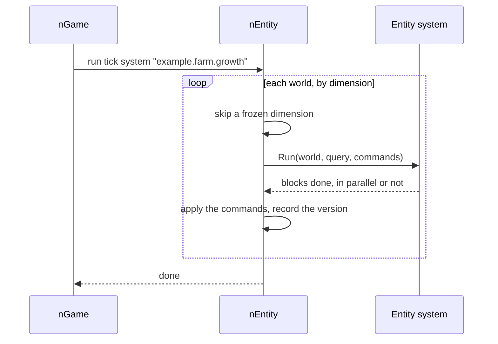

# Entity worlds

This page explains how [nEntity](../../src/nEntity/README.md) organizes the
game world into entity worlds, and how its systems fit in the simulation
tick of [nGame](../../src/nGame/README.md), and why.

## One world per dimension

A game may have several dimensions, each with its own clock in nGame. nEntity
gives each dimension its own [entity world](glossary.md#entity-world): the
entities of one dimension never share storage, queries, or archetypes with
those of another.

- **Isolation comes for free.** A query never filters entities by
  dimension, and the systems skip a dimension whose clock is frozen.
- **Dimensions stay independent.** Since no world refers to another, nothing
  ties the simulation of one dimension to another.

Component types and systems belong to the context, not to a world: they are
registered once, while modules initialize, and serve every world. Worlds come
and go with world sessions: the module that owns the dimensions creates them
when a session starts and destroys them when it ends. On the client, only the
world of the dimension the player sees exists.

## Entity systems in the tick

nGame orders every piece of code of the tick, and knows nothing of entity
worlds. nEntity bridges the two: each entity system becomes one tick system,
which runs the entity system once per world.

- **One place for the order.** Entity systems are ordered with every other
  tick system, by stage and constraints, so a voxel system and an entity
  system can say which runs first. The order is the same in every world.
- **A deterministic order of worlds.** Worlds are visited in the order of the
  identifiers of their dimensions.
- **Parallelism inside a system.** Systems run one after another on the loop
  thread, as nGame runs all tick systems. A system with many entities spreads
  its blocks over the worker threads of the core, as a `parallel for`, and
  waits for them before the next world. Below a number of blocks, it stays on
  the loop thread: waking worker threads costs more than it saves for a small
  amount of work.

## Declared accesses

Each entity system declares the components it reads and writes. Each
component is one piece of data of the job system for the whole context, and
the structure of the worlds is one more. nEntity hands these data to nGame
and to the jobs of the system, so:

- in development mode, touching a component the system does not declare
  throws, wherever the access happens, on the loop thread or in a job;
- nGame knows what each system touches, which it needs to run systems with
  separate accesses in parallel one day, without changing any module.

The data are shared by the worlds of a context rather than made per world:
a system finishes a world before it starts the next, so finer data would buy
nothing today.

## Structural changes

Entities are stored by [archetype](glossary.md#archetype): those with the same
components share blocks of unmanaged memory, one column per component. This
makes iteration fast, and makes a structural change (an entity that gains or
loses a component, or is created or destroyed) cost a move of the entity.

So:

- while a system runs on a world, the structure of that world is locked, and
  structural changes go into a command buffer applied after the system;
- a state that comes and goes often lives as a value in a component the
  entity always has, not as a component added and removed;
- the parent of an entity is a value too, so changing parents moves nothing.

## Change detection

Writes to a component whose changes someone reads, such as a component sent
over the network, are recorded with a version per entity, and a version per
block. A reader first skips the blocks whose version is older than its last
read, then picks the entities that changed in the others. When writes are
scattered over the world, nearly every block holds one: the version per
entity is what keeps the reader from getting every entity of those blocks.
