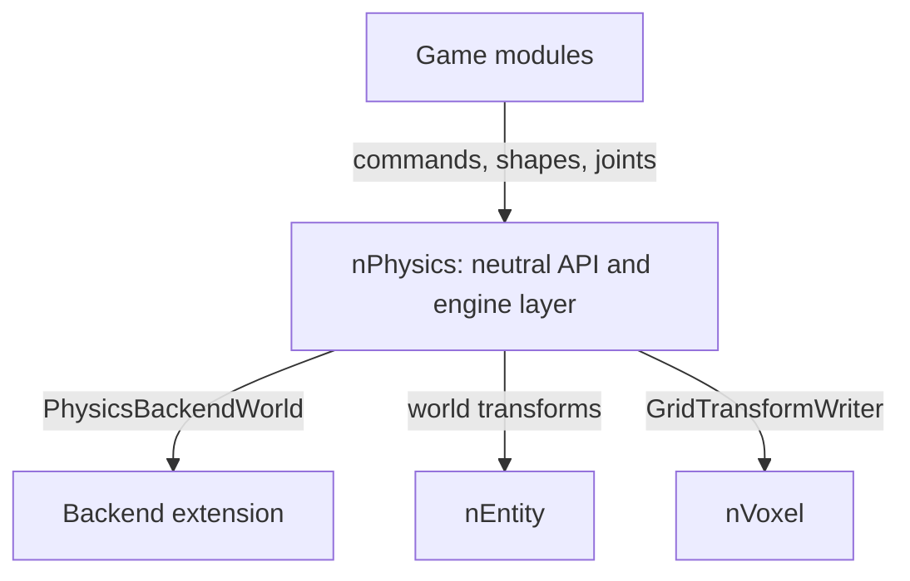
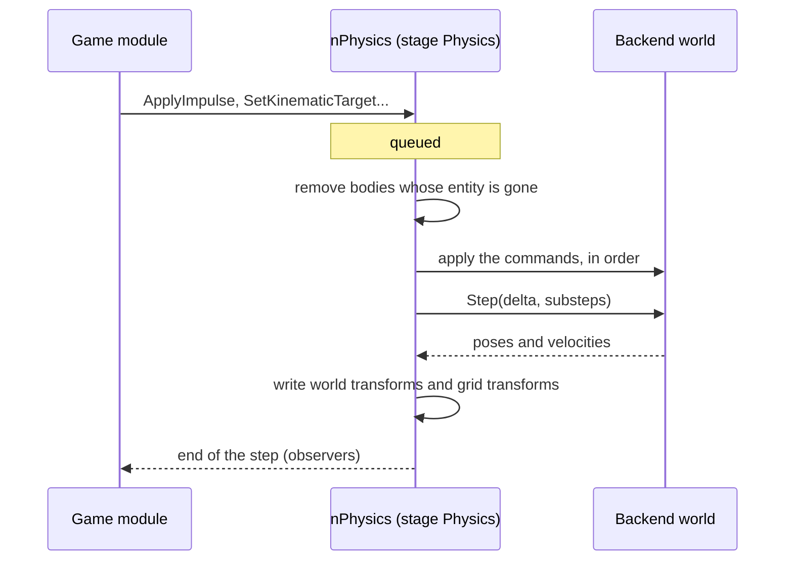

# The physics of nPhysics

This page explains how nPhysics is layered, why it is the only module that
moves simulated things, how a step turns commands into transforms, and how
bodies collide with voxels without any geometry built from them. Terms
are defined in [the glossary](glossary.md). The API is described in [the
module sheet](../../src/nPhysics/README.md).

## Layers

nPhysics is split so that what makes a voxel engine stays in the engine, and
the physics library can change:

| Layer | Content | Where |
| --- | --- | --- |
| Neutral API | Shapes, [bodies](glossary.md#body), materials, [collision layers](glossary.md#collision-layer), joints, commands, the end of each step | nPhysics, namespace `Nobara.Physics` |
| Engine layer | Bodies as entities, the queue of commands, the writing of transforms, [physics worlds](glossary.md#physics-world) and their origins, the providers of medium | nPhysics |
| Backend | Rigid bodies against each other, their broad phase, the solver, joints, sleep | a backend extension |



Modules depend on nPhysics, never on a backend. No type of the physics
library appears in the neutral API: a need that it does not cover enriches
the neutral API, with a concept that every serious physics library offers.
Collisions with voxels belong to the engine layer too (see [Collision with
voxels](#collision-with-voxels)); so will the character controller, queries,
and contact events, which this version does not have yet.

## The movement authority

Only nPhysics writes the position of a simulated entity or the transform of
a grid. With one writer per position, two modules can never fight over where
something is, and entities and grids collide in the same simulation without
being synchronized at each tick.

- A body is an entity with the components of nPhysics. After each step in
  which it moved, nPhysics writes its world transform. A transform that
  another module writes to it is overwritten at the next step: that module
  sends a command instead.
- A grid keeps the transform it was created with. nVoxel gives the writer of
  grid transforms only to the module that reserves the exclusive resource
  `voxel.grid.transform`, and nPhysics reserves it. When a grid entity is a
  body, nPhysics moves the grid through that writer, which also updates the
  spatial index of the grids.
- Entities that are not bodies are not simulated: their module writes their
  transform, as before.

Without a module that makes grids bodies, grids do not move.

## Commands and the step

A module asks for a movement through a command: a force, an impulse, a
velocity, a kinematic target, or a teleport. Changes of what a body is made
of, such as its kind or its shape, are commands too. Commands are queued and
applied in the order they were given, at the start of the next step, so that
every module sees the same state during the tick and the backend is called
from one place.



The step runs once per tick, in the stage `Physics` of nGame, with the
duration of the tick, divided into substeps that keep stacks and joints
stable. The pause and the time scale of nGame act on the ticks, not on the
step: paused, nothing steps; faster, more steps run per second, each the
same.

The end of each step is published with the bodies it wrote: a module that
keeps a history of positions by tick, such as for the compensation of
latency, starts there.

## Physics worlds and precision

A physics world is one simulation of the backend, with an origin at the
corner of a whole chunk. Positions in it are offsets from that origin in
single precision. `PhysicsFrame` is the only place that converts between
them and `WorldPosition`, whose chunk coordinates are whole numbers: the
offset is computed from the difference of the chunk coordinates first, so a
body a billion blocks from the origin of the world is as precise as one near
it, and no absolute coordinate in single precision reaches the backend.

Physics worlds share nothing, so several can step independently, and
nPhysics keeps one for each region.

## Regions at local origins

The physics runs only where something is simulated: in the active areas
around the players. nPhysics reads the active area tickets of the terrain
of each dimension, and turns them into regions. A region is a box of
chunks, the box of one ticket or of several tickets that share a chunk,
with an origin, the chunk at its center, and a physics world of its own once
a body enters it.

```text
    ticket A          ticket B                       ticket C
  +---------+       +---------+                    +---------+
  | region 1|       | region 2|                    | region 3|
  |    o    |  gap  |    o    |                    |    o    |
  +---------+       +---------+                    +---------+
         ticket A moves right: A and B share a chunk
  +-----------------------+                        +---------+
  |       region 1        |   one world,           | region 3|
  |          o            |   the bodies of 2      |    o    |
  +-----------------------+   moved into it        +---------+
```

- **Membership.** A body belongs to the region that holds its center. When
  it leaves, it moves to the world of the region it enters, with its pose
  and its velocities; a body that no region holds is frozen. A body stays
  in its region while it is less than a block out of it, so that a body on
  a border does not go back and forth. Joined bodies stay together, in the
  region of the first body of their group.
- **Borders.** Two regions can touch. A body near the border of the region
  next to its own is seen there as a ghost: a body of the same kind, placed
  again before each step where the body is. A dynamic ghost has the mass of
  its body, so that what it rests on carries its weight, and what the other
  world does to it is dropped; a kinematic ghost only pushes. A stack across
  a border then stands, where kinematic ghosts would push its lower boxes
  out from under the others.
- **Merges and splits.** Regions whose boxes share a chunk merge: the bodies
  of one move to the world of the other, the one with the most bodies. The
  islands of a merged region stay together until two empty chunks lie
  between them, so that two players at the edge of each other's area do not
  merge and split at every step.
- **Recentering.** A region follows the tickets that make it. When its
  center drifts more than eight chunks from its origin, its bodies move to a
  new world around the center: coordinates in a world stay within a few
  hundred blocks, however far a player travels.
- **Steps.** Each world steps on its own: the one with the most awake bodies
  on the loop thread, where its backend may spread it over the workers, and
  the others at the same time, in one parallel job.

Why not a single origin that moves with the player, as many engines do?
There is one player per client, but a server simulates around all of them:
one origin cannot be near players a million blocks apart, and moving it
moves every body. Regions keep an origin near each group of bodies, and the
independent regions are the unit in which the server steps in parallel.

## Collision with voxels

A physics library collides bodies with meshes or with shapes it knows. The
usual way to put a voxel world in it is to build a mesh of the surface of
each chunk, and to build it again whenever a block changes. nPhysics builds
nothing: the backend reads the blocks of a chunk where nVoxel keeps them,
while it steps.

- **Which chunks.** Before each step, each dynamic body takes the chunks
  that its bounds reach, grown by its velocity over the step and one block,
  in the frame of every grid around it. Its world hands those chunks to the
  backend, and keeps a chunk for 30 steps after the last body lets it go,
  so that a body on the border of a chunk does not add and remove it at
  every step. A sleeping body keeps its chunks without looking again.
- **What a cell is.** When nPhysics starts, it reads the collision of every
  block state from the shape registry of nVoxel: one box for a cube, the
  boxes of its shape for a model or a part of a multi-block, already turned
  by the orientation of the state. The backend finds the cells that a body
  overlaps from their coordinates, then reads the state of each cell from
  the chunk and its boxes from that table. A shape that depends on the
  instance gives its boxes from the block data of the cell; nPhysics computes
  them when the chunk enters a world, and again when that cell changes.
- **Inner faces.** A box that slides over a floor made of cubes meets the
  edges of the cells under it: the contact on such an edge has a sideways
  normal, and the box stops or tips over. A face of a cell that the cell next
  to it covers whole cannot be reached without going through that
  neighbor, so a contact that leaves a box through such a face is dropped.
  The floor then behaves as one flat surface.
- **Changed blocks.** Since nothing is built, a block placed or broken costs
  nothing to the physics: the next step reads the new state. nVoxel notifies
  every batch of changed blocks; nPhysics wakes the bodies around them at the
  next step, so that a crate asleep on a block that breaks falls.
- **Freezing.** A body that reaches a chunk of the terrain that is not
  loaded, or not active, is frozen, as a body outside every region is: it
  would otherwise fall through the missing blocks and be lost below the
  world. It moves again with the velocities it had once the chunk is active.

## Backends

A backend extension implements `IPhysicsBackend` and `PhysicsBackendWorld`
and registers with nPhysics while it initializes. nPhysics requires a
backend on both sides: the build of a distribution that activates nPhysics
without one fails, and so does the start of a context in which none
registers. When several are present, the configuration key
`physics.backend` chooses one.

nPhysics identifies a shape once; a world of the backend builds its own
shape the first time a body uses it, from the neutral description. Bodies
and joints keep a stable handle in nPhysics, while the backend numbers them
in each world. Only nPhysics calls a world of the backend, never from two threads at
once on the same world, and its members are hot path code: a step allocates no managed memory once its
tables have grown.

The engine ships one backend, nPhysics.Bepu, on BEPUphysics v2: a library in
pure C# that keeps its memory in unmanaged pools, lets the engine run its
step on the job system, and lets a backend add its own collidables. The
last point is why it was chosen: the voxels enter its solver through a
collidable of the backend that reads each chunk where it is, so that a block
placed or broken costs nothing to the physics. A world steps on the thread
that calls it, and spreads over the workers of the job system only when it
has many awake bodies; nPhysics tells it, with `PhysicsStepSettings.MaySpread`,
whether waiting for other jobs is allowed. What BEPUphysics lacks, a
coefficient of restitution, the backend adds after each step. See [the
module sheet](../../src/nPhysics/README.md#nphysicsbepu).
