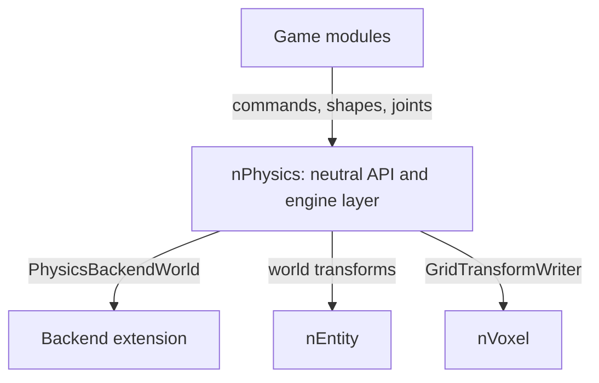
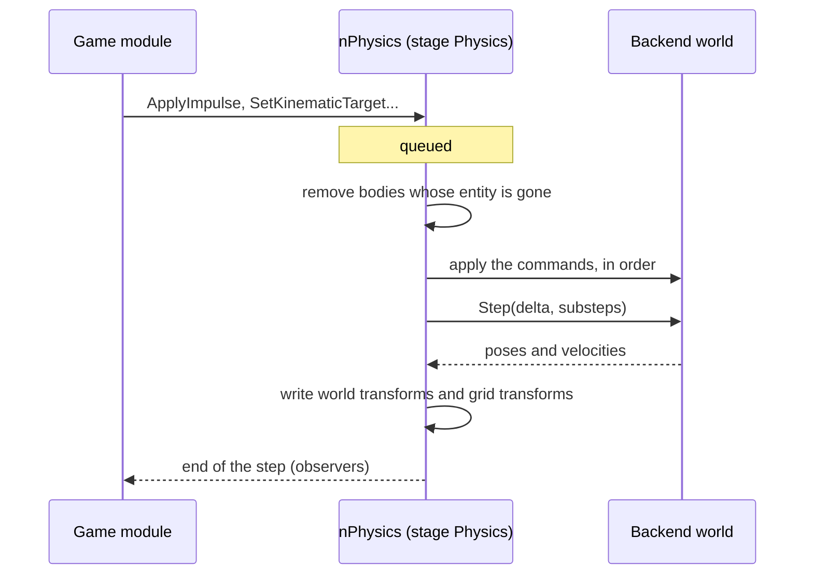

# The physics of nPhysics

This page explains how nPhysics is layered, why it is the only module that
moves simulated things, and how a step turns commands into transforms. Terms
are defined in [the glossary](glossary.md). The API is described in [the
module sheet](../../src/nPhysics/README.md).

## Layers

nPhysics is split so that what makes a voxel engine stays in the engine, and
the physics library can change:

| Layer | Content | Where |
| --- | --- | --- |
| Neutral API | Shapes, [bodies](glossary.md#body), materials, [collision layers](glossary.md#collision-layer), joints, commands, the end of each step | nPhysics, namespace `Nobara.Physics` |
| Engine layer | Bodies as entities, the queue of commands, the writing of transforms, [physics worlds](glossary.md#physics-world) and their origins, the providers of medium | nPhysics |
| Backend | Rigid bodies against each other, their broad phase, the solver, joints, sleep | a backend extension |

Modules depend on nPhysics, never on a backend. No type of the physics
library appears in the neutral API: a need that it does not cover enriches
the neutral API, with a concept that every serious physics library offers.
Collisions with voxels, the character controller, queries, and contact
events belong to the engine layer and come later.

## The movement authority

Only nPhysics writes the position of a simulated entity or the transform of
a grid. With one writer per position, two modules can never fight over where
something is, and entities and grids collide in the same simulation without
being synchronized at each tick.

- A body is an entity with the components of nPhysics. After each step in
  which it moved, nPhysics writes its world transform. A transform that
  another module writes to it is overwritten at the next step: that module
  sends a command instead.
- A grid keeps the transform it was created with. nVoxel gives the writer of
  grid transforms only to the module that reserves the exclusive resource
  `voxel.grid.transform`, and nPhysics reserves it. When a grid entity is a
  body, nPhysics moves the grid through that writer, which also updates the
  spatial index of the grids.
- Entities that are not bodies are not simulated: their module writes their
  transform, as before.

Without a module that makes grids bodies, grids do not move.

## Commands and the step

A module asks for a movement through a command: a force, an impulse, a
velocity, a kinematic target, or a teleport. Changes of what a body is made
of, such as its kind or its shape, are commands too. Commands are queued and
applied in the order they were given, at the start of the next step, so that
every module sees the same state during the tick and the backend is called
from one place.

The step runs once per tick, in the stage `Physics` of nGame, with the
duration of the tick, divided into substeps that keep stacks and joints
stable. The pause and the time scale of nGame act on the ticks, not on the
step: paused, nothing steps; faster, more steps run per second, each the
same.

The end of each step is published with the bodies it wrote: a module that
keeps a history of positions by tick, to compensate for latency later,
starts there.

## Physics worlds and precision

A physics world is one simulation of the backend, with an origin at the
corner of a whole chunk. Positions in it are offsets from that origin in
single precision. `PhysicsFrame` is the only place that converts between
them and `WorldPosition`, whose chunk coordinates are whole numbers: the
offset is computed from the difference of the chunk coordinates first, so a
body a billion blocks from the origin of the world is as precise as one near
it, and no absolute coordinate in single precision reaches the backend.

Physics worlds share nothing, so several can step independently: one per
dimension today, created around the first body of the dimension. The
interface already allows more of them in one context, such as one per zone
of simulation.

## Backends

A backend extension implements `IPhysicsBackend` and `PhysicsBackendWorld`
and registers with nPhysics while it initializes. nPhysics requires a
backend on both sides: the build of a distribution that activates nPhysics
without one fails, and so does the start of a context in which none
registers. When several are present, the configuration key
`physics.backend` chooses one.

nPhysics identifies a shape once; a world of the backend builds its own
shape the first time a body uses it, from the neutral description. Bodies
and joints keep a stable handle in nPhysics, while the backend numbers them
in each world. The backend is called only on the loop thread, and its world
members are hot path code: a step allocates no managed memory once its
tables have grown.
