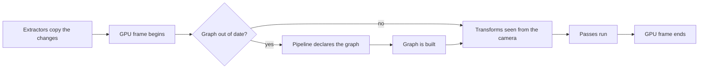

# Frames of the renderer

This page explains how [nRenderer](../../src/nRenderer/README.md) organizes a
frame: the render world and its extraction, the interpolation between ticks,
the positions relative to the camera, and the render graph, and why.

## The steps of a frame

Everything runs on the loop thread of the client context, in the phase
`Render`. Only the transforms of the objects are computed by jobs, when there
are many.

## Why a render world filled by extraction

nRenderer never draws from the state of other modules. At each frame, each
module copies what it draws to the [render world](glossary.md#render-world),
and the frame is drawn from that copy only.

- The frame sees a consistent state: no module changes what is being drawn
  while it is drawn.
- Rendering can move to a thread of its own later, drawing frame N while the
  loop simulates the next one, without changing a module: the copy is already
  the only thing the renderer reads.
- The renderer knows nothing of the data of other modules. A module without
  an entity component system draws objects made of a mesh, materials, and a
  transform.

The world keeps its objects from one frame to the next, so an
[extractor](glossary.md#extractor) copies only what changed: the objects that
appeared, moved, or disappeared. A large static scene costs nothing to
extract once it is in the world.

## Why objects are interpolated between ticks

The simulation runs at a fixed tick, 30 times per second by default; frames
run as fast as the GPU allows. Drawing the state of the last tick would show
the same image for several frames, then a jump. The render world keeps the
last two states of the simulation of each object, and draws each moved
object between them, by the fraction of tick that the loop has accumulated.
The image is one tick late, and motion is smooth at any frame rate.

An object that appears, jumps, or is moved by the frame rather than the tick
must not slide from an old state: it is placed with `Teleport`, or created,
and drawn where it is. An object that did not move during the last tick is
drawn at its last state, so nothing is interpolated forever.

## Why positions are relative to the camera

A single-precision float loses precision away from its origin: one million
blocks from the origin, its step is about 6 cm, and objects shake. A
[world position](glossary.md#world-position) keeps whole chunk coordinates
and a small position in the chunk, so its precision is the same everywhere.
The renderer subtracts the position of the camera from each position on the
CPU, in double precision; the GPU only sees offsets from the camera, which are
small for everything near enough to be seen.

The projection uses [reversed depth](glossary.md#reversed-depth): with a
floating-point depth buffer, putting the near plane at 1 and the far plane at
0 spreads precision evenly over the distance, which the long distances of a
voxel world need. The far plane can then be infinite.

## Why a render graph

A [render pipeline](glossary.md#render-pipeline) declares its
[passes](glossary.md#render-pass) and what each one reads and writes, rather
than recording commands itself. From these declarations, nRenderer:

- removes passes whose result nothing uses, so a pipeline can declare
  optional effects and let unused ones fall away;
- creates the [transient resources](glossary.md#transient-resource) of the
  frame, and shares a texture between passes that do not use it at the same
  time, which saves GPU memory;
- inserts the barriers that make writes of compute shaders visible to the
  passes that read them, which a pipeline would otherwise place by hand;
- lets other modules add passes at the
  [insertion points](glossary.md#insertion-point) of any pipeline. The user
  interface and debug drawing are drawn this way, and work with every
  pipeline without depending on one.

The graph is built when it changes, not at every frame: a new size of the
window, another pipeline, a new insertion. A frame then runs a list prepared
in advance, without allocating managed memory, which keeps the garbage
collector away from the frame.

## Why one view

The model of a [view](glossary.md#view) has a camera, a target, a viewport,
and a pipeline, so split screen, cameras that draw to textures, mirrors, and
portals fit in it. For now nRenderer draws one view; the render resolution
of the view is apart from its viewport, so a pipeline can draw at a lower
resolution and upscale later.

## Why debug drawing costs nothing outside development

Debug lines are useful in every module, so calls to them stay in the code.
Outside development mode, each call returns after one test, nothing is
stored, and no pass or GPU object exists, so a released game pays nothing for
them.
