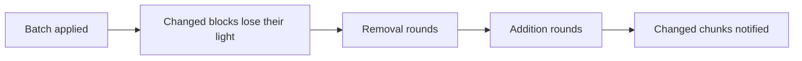
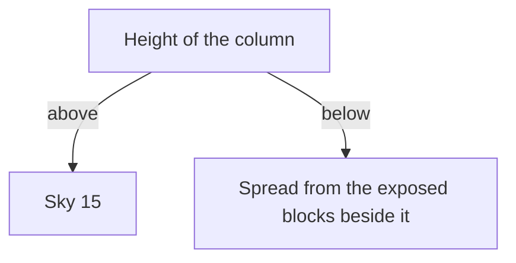

# Voxel lighting

This page explains how nLighting stores and spreads the light of voxel
grids, why every context reaches the same light from the same blocks, how
the sky, moving grids, and moving lights fit in, and why the propagation
works within a budget per tick.
The API is in [the nLighting module sheet](../../src/nLighting/README.md).

## Two channels per block

Each block holds two light channels, each from 0 (dark) to 15 (full):

| Channel | Meaning |
| --- | --- |
| Sky light | How much the block is exposed to the sky: 15 in the open, less under a roof or in a cave. |
| Block light | The light of the blocks that emit, spread from block to block. With color, it has a red, a green, and a blue component. |

Color is a choice of the distribution, with the configuration key
`lighting.color`. Without it, a block takes one byte: four bits of sky and four
of block light. With it, two bytes: four bits of sky and four for each
component.

Lighting is a module of its own on top of nVoxel. nVoxel stores blocks and
knows nothing of light; nLighting keeps its own storage, chunk by chunk, in
the grid of each chunk.

## Uniform chunks

Most chunks hold the same light in every block: a chunk of air in the open
sky is all full sky without block light, a chunk of solid rock deep below is
all dark. Such a chunk stores one value. It takes an array, in native memory,
at the first block whose light differs, and goes back to one value when a
pass leaves every block equal again. Only the chunks where light varies,
near the surface or around a lit cave, pay for an array: 32 KiB, or 64 KiB
with color.

## Sources and filters

A block emits light when its type declares the free property
`<LightEmission>`, and a state can change it through a variant, like a
lantern that is lit or not. A block takes some light from what crosses it
with `<LightFilter>`: with color, each component on its own, so that a red
glass lets only red through.

The shape of a block decides where light goes. A block whose `<Opacity>` is
`opaque` closes the faces that its oriented shape covers: a cube closes all
six, a bottom slab only its bottom. A block closed on its six faces lets its
own light out and no light in, so that a glowing cube shines.

nLighting reads these properties once, when it starts, into a table indexed
by block state. The propagation reads nothing else: the table is the registry
of the light sources.

## The rule

The light of every block follows one rule: a block holds the brightest of
its own sources and of the light of each neighbor whose shared face is open,
minus one level per block and minus its own filter. The sources of a block
are its emission and, for the sky channel, full sky when it is exposed (see
[the sky](#the-sky)). Each component of the block channel, and the sky
channel, follows the rule on its own.

For a source of 14 in open air, the block beside it holds 13, the next one
12, and the light stops after 14 blocks. Around a wall, light follows the
shortest path through open faces.

## Spreading by queues

nLighting does not compute the rule from scratch after each change. It keeps
the light it has and corrects it, with two queues:

- the **addition queue** holds blocks whose light may now raise a neighbor.
  A block leaves the queue, and each neighbor whose value would rise takes
  the new value and joins the queue;
- the **removal queue** holds blocks whose light went away. Each neighbor
  dimmer than the light that went away may have received it from there: it
  goes dark too, and joins the removal queue. A neighbor as bright or
  brighter has light of its own path, and joins the addition queue to fill
  the dark blocks again.

When a block changes, such as a torch placed or a wall broken, the light it
no longer gets goes away through every face, then its own sources and its
six neighbors join the addition queue; when its faces change, all of its
light goes. A pass empties every removal queue first, then every addition
queue.

## Jobs and chunk faces

A pass runs in rounds of jobs, at the `Late` stage of the tick. A round is
a parallel job with one index per lane, at most one lane per worker. The
chunks that have work are dealt to the lanes in turn; a lane empties the
queues of each of its chunks, one after the other, with its own buffers, and
writes only their light. A chunk thus has a single writer in a round. A front that crosses a face
of the chunk waits on that face; between two rounds, the loop thread hands it
to the chunk on the other side, which goes on in the next round. Rounds
follow until no front remains, or until the [budget](#a-budget-per-tick) of
the tick is spent.

A front that reaches a chunk that is not loaded stops. The light it carried
stays on the face of the loaded chunk: when the other chunk loads, the lit
blocks of that face join the addition queue, and the light goes on as if
both chunks had been there. When a chunk leaves memory, the light that came
from it leaves its neighbors, since the chunk may come back different, such
as without the torch it had.

## The sky

nVoxel keeps a height map: for each column of blocks, the highest opaque
block it knows. A block above the height of its column is exposed, and its
sky channel is 15. Under it, the sky spreads by the same rule as the light of
blocks: a cave lit by its opening holds 14 just inside, 13 one block
further, and goes dark when the opening closes. A filter takes its smallest
component from the sky, which is white light.

The sky channel is a stored value: the time of day never starts the
propagation again. A day and night cycle scales the sky channel when it is
drawn, and a gameplay module that needs the real brightness combines the
sky channel with the time of its own cycle.

When the height of a column moves, the blocks between the old and the new
height change exposure and their light is corrected like any other change:

- a block placed on the surface shades the column under it;
- a block broken on the surface opens it to the sky;
- a chunk that loads above can raise the height of its columns, and shade
  the chunks below it.

Space above a column that is not loaded counts as sky. A chunk of a deep
cave loaded alone, with nothing known above it, is thus lit as if it were in
the open, until a chunk above it loads, or until a save or the network gives
the height of its column.

## Grids

Every grid computes its own light, in its own frame, with the same code as
the terrain: its blocks that emit light, and its own sky, above the height
map of the grid. A grid with bounds, such as a ship, computes its height map
when it needs it. A turned ship thus has its sky along its own up axis.

A grid does not receive the light of the terrain block by block, and gives
it none. nLighting reads instead a terrain light sample for each grid that
is not the terrain: the average light of the terrain at the center and the
eight corners of the grid, without the points in a solid block or in a chunk
that is not loaded. It is meant for the renderer, which is to scale the
light of the grid by it, so that a ship that flies into a cave grows darker;
the renderer does not read it yet. The sample is read again at the
end of a tick when the grid moved or when the light of the terrain changed.

A split or a merge needs nothing of its own: the blocks that leave a grid
and those that arrive in another are ordinary changes, and the propagation
corrects the light of both.

## Dynamic light sources

A light that moves, such as a torch held in the hand, is an entity that
carries the component `nobara.lighting.dynamic_light`: a color and a radius.
Spreading it through the blocks at every move would cost a pass per tick
for each light. The brightness query adds it instead, by its distance to
the block: each component gives `floor(level × (1 − distance / radius))`, and
the brightest light wins, as for blocks. Blocks do not hide a dynamic light
from the query yet.

The query gives the channels apart: the sky channel, the block channel, and
the dynamic lights. It is what gameplay modules read, on the client and on
the server, where it exists only when nLighting runs there.

## A budget per tick

A large change, such as an explosion or thousands of blocks placed at once,
can take tens of milliseconds to light: more than a tick. nLighting bounds
the work of each tick instead. The budget counts operations: a block taken
from a queue, or a block whose light starts to change. Operations do not
depend on the speed of the machine, so a change takes the same number of
ticks everywhere, and the light is the same once the work is done.

When the budget runs out, a lane stops in the middle of a chunk, and the
blocks left in its queues wait in the chunk for the next tick. The light is
a few ticks late, never wrong: a change made in the meantime joins the work,
and a removal that crosses a face also drops the light that waits on that
face and may have come from what it removes.

The chunks nearest a point of interest go first:

- the light focuses that modules add, such as one that a client module
  moves with the camera; no module of the engine adds one yet;
- on every side, the centers of the area tickets that keep chunks active,
  such as those of the players.

Each round deals the chunks to the lanes in that order, so the light near
the players is done first and the far light follows.

## Same blocks, same light

The rule has one solution for a given set of blocks: whatever the order of
the rounds, of the chunks, or of the blocks in the queues, and however the
budget splits the work between ticks, the passes reach it. The values are integers. Two contexts that apply the same batches
therefore hold the same light, byte for byte, and a batch applied in one go
gives the same light as its blocks placed one batch after the other.

Each context therefore computes its own light from the blocks it has, and
no light is shared between contexts. A server needs the light only when it
changes the game; a distribution that does not need it there disables
nLighting for its server target.
