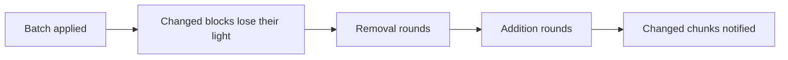

# Voxel lighting

This page explains how nLighting stores and spreads the light of voxel
grids, and why every context reaches the same light from the same blocks.
The API is in [the nLighting module sheet](../../src/nLighting/README.md).

## Two channels per block

Each block holds two light channels, each from 0 (dark) to 15 (full):

| Channel | Meaning |
| --- | --- |
| Sky light | How much the block is exposed to the sky. It is not computed yet: every block holds full sky, 15. |
| Block light | The light of the blocks that emit, spread from block to block. With color, it has a red, a green, and a blue component. |

Color is a choice of the distribution, with the configuration key
`lighting.color`. Without it, a block takes one byte: four bits of sky and four
of block light. With it, two bytes: four bits of sky and four for each
component.

Lighting is a module of its own on top of nVoxel. nVoxel stores blocks and
knows nothing of light; nLighting keeps its own storage, chunk by chunk, in
the grid of each chunk.

## Uniform chunks

Most chunks hold the same light in every block: a chunk of air in the open
sky is all full sky without block light, a chunk of solid rock deep below is
all dark. Such a chunk stores one value. It takes an array, in native memory,
at the first block whose light differs, and goes back to one value when a
pass leaves every block equal again. Only the chunks where light varies,
near the surface or around a lit cave, pay for an array: 32 KiB, or 64 KiB
with color.

## Sources and filters

A block emits light when its type declares the free property
`<LightEmission>`, and a state can change it through a variant, like a
lantern that is lit or not. A block takes some light from what crosses it
with `<LightFilter>`: with color, each component on its own, so that a red
glass lets only red through.

The shape of a block decides where light goes. A block whose `<Opacity>` is
`opaque` closes the faces that its oriented shape covers: a cube closes all
six, a bottom slab only its bottom. A block closed on its six faces lets its
own light out and no light in, so that a glowing cube shines.

nLighting reads these properties once, when it starts, into a table indexed
by block state. The propagation reads nothing else: the table is the registry
of the light sources.

## The rule

The light of every block follows one rule: a block holds the brightest of
its own emission and of the light of each neighbor whose shared face is open,
minus one level per block and minus its own filter. Each component of the
block channel follows it on its own.

For a source of 14 in open air, the block beside it holds 13, the next one
12, and the light stops after 14 blocks. Around a wall, light follows the
shortest path through open faces.

## Spreading by queues

nLighting does not compute the rule from scratch after each change. It keeps
the light it has and corrects it, with two queues:

- the **addition queue** holds blocks whose light may now raise a neighbor.
  A block leaves the queue, and each neighbor whose value would rise takes
  the new value and joins the queue;
- the **removal queue** holds blocks whose light went away. Each neighbor
  dimmer than the light that went away may have received it from there: it
  goes dark too, and joins the removal queue. A neighbor as bright or
  brighter has light of its own path, and joins the addition queue to fill
  the dark blocks again.

When a block changes, such as a torch placed or a wall broken, its light goes
away through every face, then its own emission and its six neighbors join the
addition queue. A pass empties every removal queue first, then every
addition queue.

## Jobs and chunk faces

A pass runs in rounds of jobs, at the `Late` stage of the tick. In a round,
each chunk that has work is one index of a parallel job, which empties the
queues of that chunk and writes only its light. A front that crosses a face
of the chunk waits on that face; between two rounds, the loop thread hands it
to the chunk on the other side, which goes on in the next round. Rounds
follow until no front remains.

A front that reaches a chunk that is not loaded stops. The light it carried
stays on the face of the loaded chunk: when the other chunk loads, the lit
blocks of that face join the addition queue, and the light goes on as if
both chunks had been there. When a chunk leaves memory, the light that came
from it leaves its neighbors, since the chunk may come back different, such
as without the torch it had.

## Same blocks, same light

The rule has one solution for a given set of blocks: whatever the order of
the rounds, of the chunks, or of the blocks in the queues, the passes reach
it. The values are integers. Two contexts that apply the same batches
therefore hold the same light, byte for byte, and a batch applied in one go
gives the same light as its blocks placed one batch after the other.

Each context therefore computes its own light from the blocks it has, and
no light is shared between contexts. A server needs the light only when it
changes the game; a distribution that does not need it there disables
nLighting for its server target.
